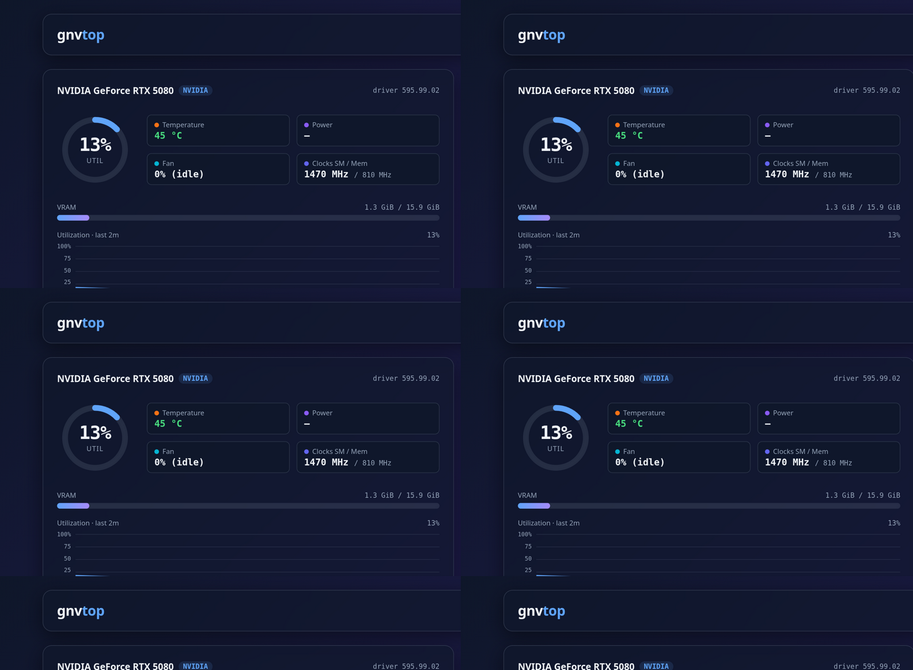

# gnvtop

**GPU monitoring in your browser — a lightweight, nvtop-style web dashboard for NVIDIA and AMD GPUs.**


*Light theme also available — [see it](docs/screenshot-light.png).*

One Python file, one HTML file, **zero dependencies** (Python 3 standard library only — no pip, no node, no build step). Binds to `127.0.0.1` only.

`nvtop` itself is an ncurses TUI with no batch/JSON output, so gnvtop queries the same data sources nvtop reads and renders them in the browser.

## Features

- **Per-GPU cards**: utilization ring gauge, VRAM bar, temperature / power / fan / clocks chips
- **Live charts** with percentage Y-axis and nvtop-style relative time X-axis
- **Process table**: every process type (C compute · G graphics · C+G), live search, column sorting, type filter, Top-N filter, scrollable with sticky header
- **Kill processes** from the UI — multi-select, confirmation dialog, SIGTERM or SIGKILL
- **Start / Stop** polling controls and an **Exit** button that stops the server
- **Light + dark themes**, three density modes, configurable poll interval, history window and warning thresholds
- Settings (including the server port) changeable from the GUI
- Polling pauses automatically in background tabs

## Install

```bash
git clone https://github.com/Apex133/gnvtop.git
cd gnvtop
./install.sh
```

This installs to `~/.local/share/gnvtop` and puts the `gnvtop` command in `~/.local/bin` (no root needed). If that directory is not on your PATH, add it:

```bash
echo 'export PATH="$HOME/.local/bin:$PATH"' >> ~/.bashrc
```

Requirements: Python 3.8+, plus `nvidia-smi` (NVIDIA driver) for NVIDIA GPUs and/or an amdgpu kernel driver for AMD GPUs. To install somewhere else: `PREFIX=/opt/gnvtop ./install.sh`.

## Use

```bash
gnvtop              # serve on http://127.0.0.1:8399
gnvtop 9000         # custom port
```

The command runs in the foreground: **Ctrl+C (or the Exit button in the page) stops the UI.** Running it twice is safe — the second instance detects the first and exits with `gnvtop already running at http://127.0.0.1:8399`.

## Data sources

| Vendor | Source | Metrics |
| --- | --- | --- |
| NVIDIA | `nvidia-smi -q -x` (one XML call per poll) | utilization, VRAM, temperature, power, fan, clocks, per-process memory (all process types) |
| AMD | amdgpu sysfs (`/sys/class/drm/card*/device`) | utilization, VRAM; temperature/power only where the driver exposes hwmon |

Known limitations: per-process GPU *utilization* is not exposed by nvidia-smi (memory only); amdgpu sysfs has no per-process data; AMD iGPUs often expose no hwmon sensors; the kill feature cannot terminate root-owned processes (the server runs unprivileged and reports "permission denied").

## Security note

gnvtop is a **local, single-user tool**: it binds to `127.0.0.1` only and its endpoints (including process kill and server shutdown) are unauthenticated by design. Do not expose it to a network.

## Uninstall

```bash
rm -rf ~/.local/share/gnvtop ~/.local/bin/gnvtop
```

## License

[MIT](LICENSE)
